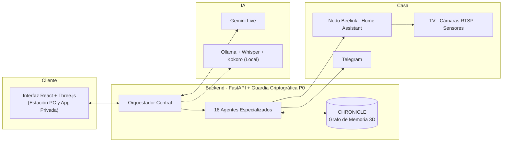

<!--
  Perfil de GitHub de Christian Martin (@ChrisMG89).
-->

  

  
  
  
  
  
  

## ▸ Qué estoy construyendo: **PROMETEO**

**PROMETEO es mi ecosistema cognitivo y domótico personal: una casa que escucha, razona, recuerda y se ve.**
Habla por voz en tiempo real, controla mi hogar, aprende por su cuenta y vive en una sede corporativa y taller 3D donde sus agentes trabajan a la vista.

> 🔒 **Proyecto privado de uso exclusivamente personal.** El código fuente, la infraestructura y la app móvil son privados y están diseñados a medida para mi propio entorno.

| Bloque | Qué hace |
|:--|:--|
| 🎙️ **Voz en tiempo real** | Conversación bidireccional con Gemini Live, reconocimiento local (Faster-Whisper + Silero-VAD), síntesis neuronal propia (Kokoro) y respaldo local con Ollama. |
| 🧠 **Escuadrón de 18 agentes** | Un orquestador cognitivo coordina 18 agentes especializados: investigación, sistema, visión artificial, memoria, agenda, finanzas, domótica, ciberseguridad, código y multimedia. |
| 🕸️ **Memoria que crece** | **CHRONICLE**: grafo de conocimiento ontológico (neuronas y sinapsis) con memoria episódica, debates en el Ágora y consolidación nocturna visible en 3D. |
| 🎓 **Academia autodidacta** | Motor de estudio autónomo con 236 materias divididas en dos fases entrelazadas (cimientos de la civilización + tecnologías de frontera como IA, computación cuántica y fusión). |
| 🏠 **Casa conectada** | Integración nativa con Home Assistant sobre servidor dedicado (Armbian/Docker), cámaras RTSP, TV y sensores, con un watchdog autónomo que diagnostica y repara el nodo por SSH si cae. |
| 🌍 **Mundos 3D interactivos** | Dos entornos en tiempo real (Sede Corporativa y Taller Speed Champions / Technic con Supra MK4 y Skyline R34) con cámara en 1.ª persona y tres modos visuales: LEGO, Habbo y realista. |
| 📱 **Control móvil cifrado** | Cliente nativo Android (Capacitor) conectado a mi servidor mediante túneles autenticados y sobres criptográficos `HS256-CTR`. |

## ▸ Arquitectura del sistema

## ▸ En cifras (medidas sobre el código real)

| | |
|:--|:--|
| **≈ 64 000** líneas de código | 31 600 de Python (105 módulos) + 32 200 de TypeScript/React (55 módulos) |
| **18** agentes · **41** rutas REST/WebSocket | orquestador, memoria vectorial, voz full-duplex, domótica, MCP |
| **236** materias en la Academia | 179 troncales (Fase 1) + 57 de vanguardia (Fase 2) en estudio continuo |
| **3** motores de estilo · **2** sedes 3D | LEGO · Habbo · realista + telemetría en vivo |

## ▸ Repositorios públicos en mi perfil

| Repo | Qué es |
|:--|:--|
| [**Atom-Estadillo_Digital**](https://github.com/ChrisMG89/Atom-Estadillo_Digital) | Aplicación y estadillo digital en Python para registrar vuelos de inspección con dron y analizar métricas operativas de flota y pilotos. |
| [**Scripts_Python**](https://github.com/ChrisMG89/Scripts_Python) | Herramientas de automatización de datos: procesamiento de CSV/Excel, renombrado masivo de imágenes de inspección y bases de datos. |
| [**Android**](https://github.com/ChrisMG89/Android) | Proyectos nativos en Kotlin y Jetpack Compose: Inventory App, Mars Photos, Race Tracker, Water Me y Work Manager. |

## ▸ Filosofía de ingeniería

- **Arquitectura propia de extremo a extremo.** Diseño e integro cada capa de mi ecosistema: desde el backend asíncrono y el enrutamiento cognitivo hasta la domótica física en Linux y los motores gráficos 3D.
- **De la idea a la pantalla.** Me gusta que los sistemas complejos se puedan ver, escuchar y controlar de un vistazo: por eso cada agente tiene su propio puesto físico en la sede 3D y su telemetría en tiempo real.
- **De los drones a la inteligencia ambiental.** Mis primeros repositorios nacieron automatizando flujos de datos para inspecciones aéreas con drones; **PROMETEO** lleva esa misma obsesión por la automatización y la telemetría al control integral de mi entorno.

## ▸ Hoja de ruta personal

- [x] Academia autodidacta en dos fases entrelazando cimientos y vanguardia
- [x] Watchdog autónomo de autorreparación SSH/Docker para el nodo domótico Beelink
- [x] Blindaje criptográfico P0 en túneles remotos y talleres 3D de alta fidelidad
- [ ] Fusibles inteligentes de sesión y puente de telefonía directa por voz

 

  

<b>🇬🇧 English summary</b>

 

**PROMETEO** is my private, custom-built AI and home-automation ecosystem: real-time voice (Gemini Live, local Faster-Whisper/Silero-VAD, Kokoro TTS, Ollama fallback), an 18-agent squad coordinated by a central orchestrator, an ontological 3D knowledge-graph memory (CHRONICLE), a perpetual self-study academy, self-healing Home Assistant infrastructure, and an interactive 3D headquarters & garage in LEGO, Habbo, and realistic styles (~64k LOC across Python and TypeScript). Strictly private and built for personal use.

