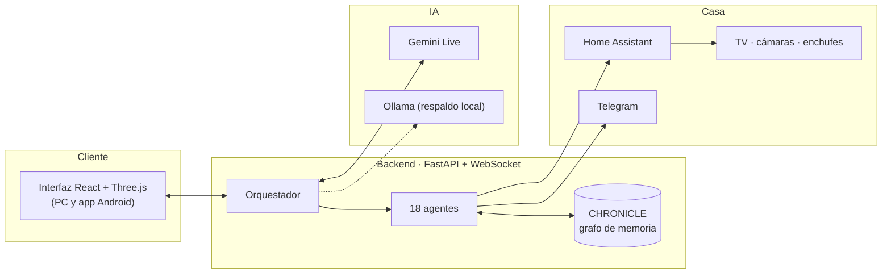

<!--
  Perfil de GitHub de Christian Martin (@ChrisMG89).
  Los SVG de assets/ están hechos a mano (paleta de PROMETEO). Para publicarlo:
  crea un repositorio PÚBLICO llamado exactamente "ChrisMG89" (igual que tu usuario) y sube este README.md y la carpeta assets/.
  Las cifras salen del código real a fecha 6-nov-2026; actualízalas cuando cambien.
-->

  

  
  
  
  
  
  

  

## ▸ Qué estoy construyendo: **PROMETEO**

**PROMETEO es mi asistente personal con IA: una casa que escucha, razona, recuerda y se ve.**
Habla por voz en tiempo real, controla mi casa, aprende por su cuenta y vive en una oficina 3D donde sus agentes trabajan a la vista.

> El código de PROMETEO es **privado**; los instaladores públicos están en [`prometeo-releases`](https://github.com/ChrisMG89/prometeo-releases).

| Bloque | Qué hace |
|:--|:--|
| 🎙️ **Voz en tiempo real** | Conversación por voz con Gemini Live, reconocimiento local (Whisper + Silero-VAD), voz propia (Kokoro) y respaldo local con Ollama cuando la nube falla. |
| 🧠 **Escuadrón de 18 agentes** | Un orquestador reparte las órdenes entre agentes especializados: investigación, archivos, visión, memoria, agenda, finanzas, domótica, seguridad, código, multimedia… cada uno con su rol. |
| 🕸️ **Memoria que crece** | **CHRONICLE**: un grafo de conocimiento (neuronas y sinapsis) con memoria episódica, debates y consolidación nocturna, visible en 3D. |
| 🎓 **Academia autodidacta** | PROMETEO estudia solo: 236 lecciones en dos fases (cimientos del conocimiento + fronteras como IA, cuántica o fusión), alternándolas. |
| 🏠 **Casa conectada** | Home Assistant en un servidor propio, Telegram, TV, cámaras, enchufes… con un vigilante que detecta y repara el servidor si se cae. |
| 🌍 **Mundos 3D** | Dos sedes (oficina y taller con Supra y Skyline) en tres estilos: LEGO, Habbo y realista, con temporadas, clima, nieve y eventos de Navidad. |
| 📱 **En el bolsillo** | La misma interfaz como app Android (Capacitor) que se conecta a casa desde fuera. |

## ▸ Cómo encaja todo

## ▸ Los números (medidos en el código, sin inflar)

| | |
|:--|:--|
| **≈ 64 000** líneas | 31 600 de Python (105 archivos) + 32 200 de TypeScript/React (55 archivos) |
| **18** agentes · **41** rutas REST/WebSocket | orquestador, memoria, voz, domótica, MCP |
| **236** lecciones de estudio | 179 de cimientos + 57 de vanguardia |
| **3** estilos visuales · **2** sedes 3D | LEGO · Habbo · realista |

## ▸ Mis repositorios públicos

| Repo | Qué es |
|:--|:--|
| [**prometeo-releases**](https://github.com/ChrisMG89/prometeo-releases) | Instaladores y versiones de PROMETEO para Android. |
| [**Android**](https://github.com/ChrisMG89/Android) | Mis apps de aprendizaje en Kotlin: Inventory App, Mars Photos, Race Tracker, Water Me, Work Manager y más. |
| [**Atom-Estadillo_Digital**](https://github.com/ChrisMG89/Atom-Estadillo_Digital) | Estadillo digital en Python para registrar los vuelos de una inspección con dron y analizarlos después (CSV de empresas y pilotos). |
| [**Scripts_Python**](https://github.com/ChrisMG89/Scripts_Python) | Colección de scripts de automatización de datos: CSV, Excel, renombrado masivo de imágenes y bases de datos de inspección. |

## ▸ Cómo trabajo

- **Pareja de trabajo con IA.** Construyo PROMETEO en pareja con agentes de IA (Gemini, Claude y Antigravity) y reviso lo que hacen.
- **De la idea a la pantalla.** Me gusta que lo que construyo se pueda ver y tocar: por eso hasta mis agentes tienen despacho.
- **Aprendiendo en público.** Mis primeros repos son scripts de datos para inspecciones con dron; PROMETEO es mi laboratorio para aprender arquitectura de sistemas, agentes y visualización 3D.

## ▸ Qué viene

- [x] Academia con dos fases alternando cimientos y vanguardia
- [x] Vigilante del servidor doméstico con historial de caídas
- [ ] Más pruebas automáticas y documentación para que otros puedan seguir el proyecto
- [ ] Nuevos estilos y escenas en los mundos 3D

 

  

<b>🇬🇧 English summary</b>

 

**PROMETEO** is my personal AI assistant: real-time voice (Gemini Live, local Whisper/Silero-VAD, Kokoro TTS, Ollama fallback), an 18-agent squad behind an orchestrator, a knowledge-graph memory (CHRONICLE), an autonomous study academy, Home Assistant integration, and a 3D office/garage in LEGO, Habbo and realistic styles — as a React/Three.js web app and an Android app (Capacitor). About 64k lines (Python + TypeScript). The code is private; public builds live in [prometeo-releases](https://github.com/ChrisMG89/prometeo-releases).

